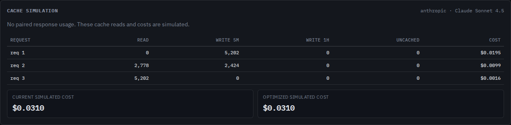

# Identical message text can belong to a different cache

The source checkout now prevents Anthropic message-cache hits across changes
to `tool_choice` or explicit image presence. Baseline `4d2183d` treated these
requests as identical. This correction is local and unreleased.

[Anthropic documents](https://platform.claude.com/docs/en/build-with-claude/prompt-caching#what-invalidates-the-cache)
that these settings affect message entries while preserving the tools and
top-level system cache. An image added after an existing breakpoint can
therefore make that message prefix miss, despite unchanged text before it.

The [compressed example](../../examples/anthropic-cache-settings.jsonl.gz)
uses three synthetic Sonnet 4.5 requests with identical tools, system text,
and messages. Only tool choice changes. There are explicit markers at the
system prompt and the first user block:

```text
request 1: auto --> writes setup + messages in the auto scope
request 2: any  --> reads setup; writes messages in the any scope
request 3: auto --> reads the earlier auto entry, including messages
```

The estimated token counts and input prices in this checkout produce:

| Request 2 | Baseline | Corrected |
| --- | ---: | ---: |
| Cache reads | 5,202 | 2,778 |
| Five-minute writes | 0 | 2,424 |
| Uncached input | 0 | 0 |
| Simulated input cost, USD | 0.0015606 | 0.0099234 |

Request 3 still reads all 5,202 modeled tokens. Without the setup marker,
request 2 reads zero: a message entry does not implicitly create a separately
addressable setup entry. Both actual and hypothetical optimized simulations
respect the settings. Optimization cannot remove a forced tool choice or an
image to manufacture savings.

These are estimated costs from controlled inputs, not measured usage or
provider charges. No model requests were sent.

## Reproduce

From the repository root:

```sh
npm ci
node studies/cache-settings/replay.mjs /tmp/cache-settings.json dist --expect-repaired
node dist/cli/index.js analyze examples/anthropic-cache-settings.jsonl.gz --verbose --json /tmp/cache-settings-report.json --html /tmp/cache-settings-report.html
```

[`cases.mjs`](cases.mjs) defines five sequences: choice with/without a setup
marker, parallel-tool policy, an image after the marked prefix, and an image
inside a later tool result. [`replay.mjs`](replay.mjs) retains input hashes,
compiled implementation hashes, both simulation scenarios, content-prefix
evidence, and findings. It checks expected read boundaries and token
conservation independently of the cache ledger's implementation.

[`before-4d2183d.json`](before-4d2183d.json) was captured after rebuilding the
baseline. [`after.json`](after.json) records the corrected output. The same
replay can target a different build by replacing its `dist` argument, including
an unpacked and installed npm package.

The browser accepts the compressed example, explains the changed settings,
and preserves counts and findings in offline JSON/HTML downloads. The cache
table and finding remain accessible at desktop and phone widths. Browser
checks also use keyboard activation, axe, and an external-network restriction.



The [phone capture](../../docs/assets/cache-settings-finding-375.png) shows the
explanation and request-navigation controls without clipping. The existing
cache table scrolls horizontally inside its panel at narrow widths.

## Scope and boundaries

Cache entries retain their captured model identity as well as these settings.
Content-based conversation inference and prefix matching remain unchanged:
matching text is useful evidence even when it cannot supply a cache hit.

The tool-choice key preserves the complete object with deterministic JSON
ordering. It normalizes only documented defaults: omitted/null choice is
`auto` with tools and `none` without tools; omitted parallel-tool disabling
equals `false`. Toolset-only bodies retain an unspecified choice. Forced tool
names and enabled parallel restrictions remain distinct. Sources:
[tool-choice defaults](https://platform.claude.com/docs/en/agents-and-tools/tool-use/define-tools#forcing-tool-use)
and [parallel-tool behavior](https://platform.claude.com/docs/en/agents-and-tools/tool-use/parallel-tool-use#disable-parallel-tool-use),
checked 2026-10-10.

Image presence follows explicit image blocks in message content, tool/MCP
results, and document content sources. An arbitrary JSON object in a tool's
input or a quoted image description is not an image. Changing image bytes
inside the prefix still changes content identity; changing an image after a
marker preserves the existing image-present scope. Opaque PDFs, URLs and
provider-rendered documents cannot reveal their image content to this parser.

This is partial request-setting coverage. Thinking/effort rules vary by model;
speed and other feature flags can affect provider-injected content. Those
changes are not fully modeled. Tokenization, TTL expiry, eviction, private
rendering, server routing and request-schema validation retain their existing
limits. The examples use a model that accepts forced tool choice; the parser
does not certify that every model accepts every input setting.
