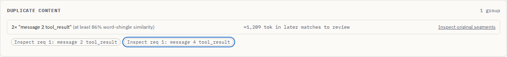

# Similar edits are evidence to inspect, not established waste

At baseline `c1adf86f375d606145840cc20d530c9a9e5fd34f`, three successive
200-line configuration snapshots became one duplicate group. The first edit
changes lines 50-59, the next also changes lines 100-109. Their actual
five-word-shingle Jaccard similarities are:

| Pair | Shared / union | Similarity |
| --- | ---: | ---: |
| Original / first edit | 182 / 210 | 86.67% |
| First / second edit | 182 / 210 | 86.67% |
| Original / second edit | 168 / 224 | 75% |

The detector joined the above-threshold edges transitively, then calculated
its group's similarity using only those edges. It called all three versions
"the same" content, reported 87% similarity, and claimed 2,418 wasted tokens.
The corrected group contains only the first two snapshots. It reports a
minimum pairwise similarity of 86.67% and 1,209 estimated tokens in the later
member **to review**. Those tokens are not established savings. The third
snapshot remains in the request and token/cache accounting.

[The runnable request](../../examples/anthropic-edited-repeats.json) contains
synthetic tool results; no provider request is needed.

Two additional failures are retained in [cases.mjs](cases.mjs):

- Two different long, single-word strings have the same 32-bit FNV fingerprint
  (`c4332357`). The old detector called them identical shingle sets, although
  their actual similarity is zero. Its across-conversation fingerprint could
  also suppress a second conversation containing its own exact repeat.
- Two conversations with different duplicate evidence at the same segment
  paths were merged by the findings display. An exact-match claim could then
  describe a later edited pair. Those findings now remain separate.

Identical copies and changed repetition are controls. Repeating a phrase more
times leaves its *set* of shingles unchanged; a 100% shingle score does
not prove identical text. All six full-analysis cases retain identical
non-duplicate JSON before and after, including token, cache, usage and prefix
results. [before.json](before.json) preserves the baseline failures;
[after.json](after.json) records the independently installed repair.

## What the source now means

Actual strings establish shingle identity and across-conversation identity.
Identical analyzed text is pooled before comparison. Distinct text joins the
first compatible group in source order only if every pair reaches 0.85. The
reported score is the minimum of all pairs. This deterministic greedy
partition is conservative and order-dependent; it does not enumerate every
qualifying pair or find an optimal clustering.

`matchKind: "exact"` means identical *analyzed text*, not identical raw message
objects, tool call IDs, timestamps, or semantic role. `"near"` means only
word-shingle similarity. Ordering, multiplicity and small but consequential
edits can survive a high score. Even exact repeated observations may be needed.
Eligibility remains system/user/assistant/tool-result segments of at least
200 characters, within terminal requests of inferred conversations.

The source library and JSON report replace `estimatedWastedTokens` with
`estimatedReviewTokens`: the sum of later members' Claude token estimates.
Consumers must update that field access. There is no removable-token or
money-savings claim. The browser exposes the original members for inspection
and raw download, including their request number. It displays the first 20
member controls; the JSON report retains all members. CLI and offline HTML
reports use the same distinction and review budget. Offline HTML does not
embed prompt text.

## Public-history audit

[audit-corpus.mjs](audit-corpus.mjs) checks the last reconstructed Anthropic
request from each of 240 pinned SWE-bench trajectories already used by
[the real-trajectory study](../real-trajectories/README.md). It verifies every
original source and decompressed request-body hash against the reconstruction
receipt before analysis. The manifest hash is
`da378619eb0633debd8ac970c5b321c625e091e54096cf1aa46c4a45dd1d22d2`.

This audits 240 terminal snapshots, not all 10,555 intermediate requests. It
bypasses OpenAI token counting, uses the unchanged Claude estimator for member
sizes, and independently computes every pair with raw shingle strings. It is
a grouping audit, not a new provider/cache prediction accuracy measurement.
No new network captures or model requests are involved.

The baseline's 466 groups include five whose true minimum is below 0.85:

| Trajectory set / task | Members | Reported minimum | Actual minimum |
| --- | ---: | ---: | ---: |
| Sonnet v1.13.3 / django-13346 | 3 | 85.71% | 84.92% |
| Sonnet v1.13.3 / matplotlib-24026 | 3 | 88.39% | 83.46% |
| Haiku v2 / django-13012 | 3 | 85.90% | 80.12% |
| Haiku v2 / django-14608 | 4 | 90.21% | 84.80% |
| Haiku v2 / django-16819 | 3 | 88.96% | 84.42% |

[corpus-before.json](corpus-before.json) preserves all 466 groups, source hashes
and the violating member paths. The [installed-package audit](corpus-after.json)
leaves 466 groups with zero below-threshold pairs or misstated minimums.
[The comparison](comparison.json) confirms 461 groups retain identical members,
minimums, text classification and review sizes; only the five invalid groups
change membership. There are 319 identical-text groups and 147 similar-text
groups. Group count alone is not an accuracy measure; the all-pair check is
the relevant constraint.

## Reproduce and inspect

```sh
npm ci
npm run build
node studies/duplicate-evidence/replay.mjs dist /tmp/duplicate-replay.json
node dist/cli/index.js analyze examples/anthropic-edited-repeats.json --json /tmp/duplicate-report.json --html /tmp/duplicate-report.html
node studies/duplicate-evidence/browser.mjs . /tmp/duplicate-browser.json verify /tmp/duplicate-screens
```

For the baseline, build an archive of the pinned commit and pass its `dist`
to `replay.mjs` with `baseline` as the third argument. The browser script takes
a built repository root, output path, mode, and optional screenshot directory.
It stops the actual HTTP server after analysis, uses the keyboard to inspect
both originals, downloads their complete raw objects, and compares the entire
browser JSON report with the core result. It reopens the downloaded report as
an actual `.html` file, checks the rendered title/finding, no scripts or HTTP
requests, no page/CSP errors, and no horizontal overflow. Both Chromium and
Firefox run at 1440px and 375px. [browser-before.json](browser-before.json)
retains the original false claim in all four environments;
[browser-after.json](browser-after.json) records the corrected group and raw
downloads from the clean build.

To rerun the corpus audit, first obtain the pinned sources and reconstructed
bodies using the existing [cache reconstruction study](../cache-accounting/README.md),
then run:

```sh
node studies/duplicate-evidence/audit-corpus.mjs /path/to/built/dist /path/to/reconstructed-corpus . /tmp/corpus.json
node studies/duplicate-evidence/benchmark.mjs /path/to/baseline/dist /path/to/after/dist /tmp/timing.json
```

The benchmark times only duplicate detection on identical 5,089-byte synthetic
settings blocks. [All three alternating samples](benchmark.json) are retained.
Median milliseconds on this machine with Node 24.21.0:

| Repeated segments | Baseline detector | Corrected detector |
| --- | ---: | ---: |
| 100 | 35.81 | 0.45 |
| 500 | 559.87 | 1.22 |
| 1,000 | 2,310.55 | 0.86 |

Pooling equal text avoids reshaping and comparing every copy. These are short,
noisy component timings for a favorable identical-text workload, not an overall
speedup claim. Parsing/tokenization are outside the timed region; this does not
measure end-to-end latency, memory, or workloads with mostly unique content.

## Artifact and browser verification

A fresh archive of source commit `39cc8cc3a851ce9ca257530fbaa9627e6b033ba5` passed `npm ci`, lint, type checking, 462 unit
checks, the production build, and 90 browser workflows on Node 24.21.0.
[artifacts.json](artifacts.json) records the build inputs, which are identical
to the final documented source. Subsequent changes add only study
evidence and documentation. The receipt compares 107 inputs (including the
examples symlink and its tracked target files), 10 files served by the local
browser harness, and all 92 installed compiled files against the clean build.
It also hashes 32 core files unchanged from the baseline.

The archive's npm tarball was installed into a separate directory, then the six
full analyses and real CLI were run on Node **20.0.0** and **24.21.0**. Their
complete results agree. [installed.json](installed.json) retains the tarball
hash and full JSON/HTML comparisons. The HTML comparison excludes exactly one
wall-clock generation timestamp; each original file hash is also retained.
All four browser downloads agree with the installed CLI's HTML on every other
byte. Four additional offline browser openings render the CLI's actual `.html`
file, with no scripts, network requests, page errors, or horizontal overflow.

The browser integration cases also cover exact and similar evidence at reused
paths, cross-request inspection while another request remains selected, focus
return, raw-download preservation, and accessibility at both widths. All four
baseline and eight final panel screenshots were opened and visually inspected.



[Phone group](../../docs/assets/duplicate-evidence/after/chromium-375-group.png),
[original-segment inspector](../../docs/assets/duplicate-evidence/after/chromium-375-original.png),
and [baseline claim](../../docs/assets/duplicate-evidence/before/chromium-375-group.png)
show the actual before/after interface. These are local production-build captures.

This is a source repair. The npm version remains 0.3.3; no registry release,
release tag or hosted deployment accompanies this work.
