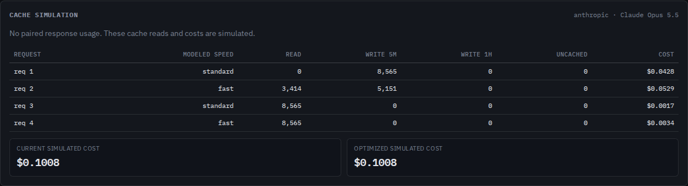

# A speed change is not a free cache hit

At `227d6d8`, Contextscope treated identical Claude Opus 5.5 requests at
standard and fast speed as one cache scope and charged both at standard
input rates. The retained synthetic example changes only `speed`:

```text
standard --> fast --> standard --> fast
 write       read      reuse        reuse
 all       tools only  standard     fast
```

The request has explicit markers on tools, system text, and the user block.
Measured outputs from the local simulator are:

| Second request | Before | Corrected |
| --- | ---: | ---: |
| Estimated cache reads | 8,565 | 3,414 |
| Estimated five-minute writes | 0 | 5,151 |
| Simulated input cost, USD | 0.0017130 | 0.0528756 |

The third request reuses all 8,565 modeled tokens from the earlier standard
request. The fourth reuses the fast entry, at the fast read price. If the
tools have no marker, the second request reads zero; a cached system prefix
does not create a separately addressable tool entry.

These are controlled request bodies and estimated token costs, **not provider
usage, charges, or a measured prediction-accuracy improvement**. No model
requests were sent. The original compressed example is
[`anthropic-fast-mode.jsonl.gz`](../../examples/anthropic-fast-mode.jsonl.gz).

## Rules and scope

The [Claude prompt-caching hierarchy](https://platform.claude.com/docs/en/build-with-claude/prompt-caching#what-invalidates-the-cache)
specifically preserves tool entries across speed changes while invalidating
system and message entries. This is more precise than the fast-mode page's
general description of a speed-change miss. We follow that hierarchy and keep
cache partitions for earlier speeds, model identities, tool choices and image
presence. Neither simulation scenario changes a request's speed.

The [fast-mode documentation](https://platform.claude.com/docs/en/build-with-claude/fast-mode#pricing),
checked October 10, 2026, gives these current Claude API input rates:

| Model | Standard USD/M tokens | Fast USD/M tokens |
| --- | ---: | ---: |
| Opus 5.5 | 4 | 8 |
| Opus 5 | 5 | 10 |
| Opus 4.8 | 5 | 10 |

The premium also applies to cache reads and both write TTLs. The same
documentation says Opus 4.6 currently accepts `speed: "fast"` but runs at
standard speed; its scope and rate remain standard in this model. Omitted
speed and explicit `"standard"` are equivalent. Other speed values remain
distinct and unpriced. Unsupported fast model/rate combinations produce
warnings and no cost totals, rather than borrowing a standard price.

When any request specifies speed, every Anthropic simulation row exports
`speed` and, when known, `inputPriceMultiplier`. The speed is modeled, not
observed. JSON omits undefined cost/multiplier values. Terminal, browser and
offline HTML tables label the column "modeled speed". With no speed settings,
the existing row shape is unchanged.

This uses current rules, not a historical pricing database. Request bodies
cannot verify response speed, beta headers, cloud-platform availability,
provider-injected tokens, TTL expiry or eviction. `--model` still overrides
pricing assumptions while cache identity follows the captured model. Thinking,
effort, citations and other feature flags retain the documented coverage limits.

## Replay

```sh
npm ci
node studies/fast-mode/replay.mjs /tmp/fast-mode.json dist --check
node dist/cli/index.js analyze examples/anthropic-fast-mode.jsonl.gz --json /tmp/fast-mode-report.json --html /tmp/fast-mode-report.html
```

[`cases.mjs`](cases.mjs) supplies seven sequences covering missing tool markers,
both TTLs, the three supported fast models, the current fallback, and unavailable
pricing. [`before-227d6d8.json`](before-227d6d8.json) and [`after.json`](after.json)
retain input/implementation hashes, both simulation scenarios, prefix matches
and explanatory findings. `replay.mjs` checks read boundaries, token conservation
and the independent rate arithmetic. Its `dist` argument can point at an installed
npm package. All work described here is local; it does not update the registry
package or hosted site.



The [phone capture](../../docs/assets/fast-mode-finding-375.png) shows the
explanations without clipping. The browser workflow checks the compressed
input, keyboard inspection, both offline downloads, narrow and desktop layouts,
and accessibility in Chromium and Firefox.

## Historical regression replay

[`corpus.json`](corpus.json) records a comparison against `227d6d8` on 240
previously reconstructed public Claude trajectories, containing 10,555 requests.
The replay checked every request-body SHA-256 from the reconstruction manifest.
Both simulation scenarios are byte-identical on these bodies, which contain no
speed settings. This guards the existing workflow; it does not validate the new
fast-mode predictions against provider usage. The captured sources and pinned
reconstruction procedure are in the [accounting study](../cache-accounting/README.md).

```sh
node studies/cache-accounting/compare-corpus.mjs "$CACHE_STUDY_SCRATCH" "$BASELINE_DIST" /tmp/fast-mode-corpus.json
```

This run reused the reconstructed bodies; it did not repeat reconstruction,
download a new corpus or request new provider responses.
