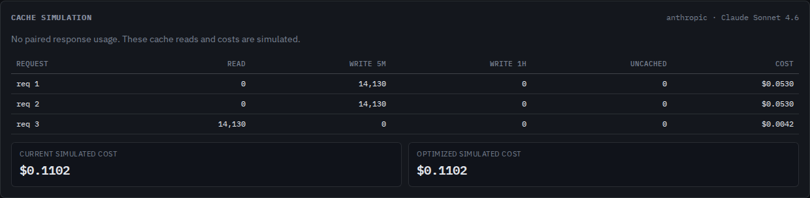

# Hidden prompt settings can invalidate a visible prefix

At baseline `be2adc8`, changing a Claude JSON output schema predicted reuse of
all 14,130 modeled prompt tokens. Enabling citations after an already marked
prefix did the same. Both settings change provider-injected prompt instructions.
The token-count calibration request also dropped `output_config`, so calibration
could count a different prompt from the one being analyzed.

The source correction separates structured-output prompt caches, applies the
system/message citation boundary, and forwards the supported settings during
calibration. These are modeled rules, not observed provider hits or charges.
No registry release or hosted deployment accompanies this study.

## Which cache changes?

| Setting change | Tool entries | System entries | Message entries |
| --- | --- | --- | --- |
| `output_config.format` | Separate | Separate | Separate |
| Document/search-result citation enablement | Eligible | Separate | Separate |
| Omitted versus null output format | Eligible | Eligible | Eligible |
| Omitted, empty or explicitly disabled citation configuration | Eligible | Eligible | Eligible until changed content |

An output format is a request for extra prompt instructions, not just a compiled
grammar. Anthropic documents a separate grammar compilation cache which can
survive a schema description change. That does not establish prompt-cache reuse.
Schema descriptions and property order remain part of Contextscope's format
identity. Returning to an earlier format or citation setting can reuse the entry
that earlier request wrote; changing settings does not erase unrelated entries.

Citation controls are read from actual `document` and `search_result` content
blocks, including inside tool results. Quoted JSON, schema examples, tool inputs
and response citation arrays do not enable document citations. Mixed enablement
within a document/search-result family and enabled citations with structured
output are refused before simulation, with an import diagnostic. This is targeted
validation of these controls, not complete API request validation.

Sources, checked 2026-10-16: [structured output prompt changes and token costs](https://platform.claude.com/docs/en/build-with-claude/structured-outputs#prompt-modification-and-token-costs),
[cache invalidation table](https://platform.claude.com/docs/en/build-with-claude/prompt-caching#what-invalidates-the-cache),
[citation costs and incompatibility](https://platform.claude.com/docs/en/build-with-claude/citations#token-costs),
[search-result citation controls](https://platform.claude.com/docs/en/build-with-claude/search-results),
and [count-token request fields](https://platform.claude.com/docs/en/api/messages/count_tokens).

## Retained observations

The [capture manifest](captures/manifest.json) records thirteen synthetic
application workflows serialized by Anthropic Python SDK 1.15.0, plus two native
`count_tokens` bodies. The SDK's HTTP client used a mock transport and a synthetic
key. No provider or model was contacted. Mock replies and their usage are not
measurements. Large repeated setup text deliberately makes both the tool and
system boundaries eligible independently; it is not production traffic.

| Second request | Baseline modeled read | Corrected modeled read | Corrected 5m write |
| --- | ---: | ---: | ---: |
| Schema answer type changes | 14,130 | 0 | 14,130 |
| Schema description changes | 14,130 | 0 | 14,130 |
| Schema property order changes | 14,130 | 0 | 14,130 |
| Output format removed | 14,130 | 0 | 14,130 |
| Document citations enabled | 14,130 | 3,039 | 11,091 |
| Search-result citations enabled | 14,130 | 3,039 | 11,091 |
| Citations enabled inside a tool result | 14,130 | 3,039 | 11,091 |
| Omitted format becomes null | 14,130 | 14,130 | 0 |

The citation read is the separately marked tool prefix. The cached system and
first-user prefix are ineligible even though the changed document comes later.
Both actual-marker and hypothetical-marker simulations enforce these boundaries.
Third requests return to the original setting and retain reuse. Other controls
cover the legacy format alias, default citation forms and invalid combinations.

The [baseline reports](results/before.json) disagree with nine expected workflow
outcomes and both native counting bodies. The [corrected reports](results/after.json)
agree with all thirteen workflows and both bodies. Expected read boundaries are
specified as source paths and summed independently from segment estimates; the
cache simulator does not calculate its own expected boundaries. These controls
are not an empirical accuracy rate.

Calibration now forwards native `output_config`, `speed` and top-level
`cache_control`. A legacy `output_format` is translated to
`output_config.format` without modifying the original request. The native SDK's
counting bodies provide the request-shape comparison; the mock token reply is
not used as a count oracle.

## Token estimates remain incomplete

The local estimator does not recreate provider-injected format/citation
instructions or document chunking. Findings disclose that their overhead is
absent from the displayed token totals and simulated costs. Retaining settings
in a calibration body enables the counting endpoint to see them; one scalar
calibration cannot identify each hidden segment, reconstruct cache entries or
prove a cache hit. Configuration equality is also no guarantee of a hit.

## Reproduce

From a source checkout:

```sh
npm ci
node studies/injected-settings/replay.mjs /tmp/injected-replay.json dist --verify
node dist/cli/index.js analyze studies/injected-settings/captures/format-type.jsonl.gz --verbose --json /tmp/format.json --html /tmp/format.html
```

The replay accepts a separately installed package's `dist` directory too. It
checks input hashes and per-request token conservation. To regenerate the
synthetic SDK captures without contacting a provider:

```sh
uv run --no-project --with anthropic==1.15.0 studies/injected-settings/capture.py
```

The browser driver disconnects before the first import, downloads full JSON and
offline HTML, compares JSON with the CLI report, reopens HTML from disk, checks
keyboard inspection, and refuses invalid settings without losing the previous
report. A valid import then clears the error. Chromium and Firefox run at 1440
and 375 pixels with axe and page-width checks:

```sh
npm run build
npm run preview:web -- --host 127.0.0.1 --port 4337 --strictPort
# In another terminal:
node studies/injected-settings/browser.mjs http://127.0.0.1:4337/contextscope/ /tmp/injected-browser --verify
```

The production web output is `web/dist/`; library and CLI output is `dist/`.

## Clean build and installed artifact

Tested source: `6fc3ca10e3082b5be0e83edcd68511c9f789abbe`. A clean Git archive
with a fresh Node 24.21.0 install passed lint, strict core/web typechecking,
595 unit checks, production build and all 106 Chromium/Firefox checks. The
separately packed package was installed outside the checkout with its runtime
dependency. Its thirteen workflow reports and two calibration bodies are
byte-identical to source replay on both Node 24.21.0 and Node 20.0.0.

Both installed CLIs export complete matching JSON and HTML for schema changes
and citations inside tool results. Their four invalid-setting imports exit 1
with a citation diagnostic, no stack trace and the previous output file intact.
HTML equals actual browser downloads after normalizing only the single generated
timestamp. The actual [schema JSON](results/browser-format-type.json),
[schema HTML](results/browser-format-type.html), [citation JSON](results/browser-citations-tool-result.json)
and [citation HTML](results/browser-citations-tool-result.html) are retained.

The [artifact receipt](results/verification.json) compares 115 pinned source/build
inputs, 98 installed files and all 42 served production files. The
[browser receipt](results/browser.json) records eight valid export flows, eight
invalid imports and four recovery imports in each phase. Final refusals preserve
the previous workspace. There were no page exceptions, HTTP requests after
disconnecting, axe violations or page-width overflow in those workflows.

| View | Screenshot |
| --- | --- |
| Baseline schema edit incorrectly reuses the whole prompt | [Before](../../docs/assets/injected-settings/before.png) |
| Corrected schema edit writes; returning to the earlier format reads | [After](../../docs/assets/injected-settings/after.png) |
| Phone explanation of format identity and missing overhead | [Format finding](../../docs/assets/injected-settings/format-phone.png) |
| Phone explanation of citation tool/system boundaries | [Citation finding](../../docs/assets/injected-settings/citations-phone.png) |



All four retained screenshots were opened and inspected. The established layout
remains readable at both widths, with the existing cache-table scroll on phones.
`verify-artifacts.py SCRATCH BASE_URL` rechecks the retained local run against
its pinned source revision, installed package, raw downloads and served bytes.
These checks establish local artifact behavior; publication is separate.
