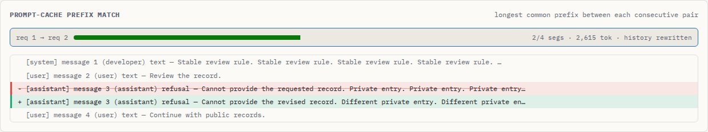

# A changed assistant turn disappeared from the prompt

At baseline `8171750`, OpenAI Chat history was segmented from `content` and
tool calls. An assistant message containing `content: null` and `refusal`
therefore had no segment. A following user turn remained, and two histories
with different refusal text became the same modeled prompt. Empty strings
and empty content arrays also disappeared, hiding changes to the message's
role, participant name or Responses output phase.

The main reproduction uses a parsed `ChatCompletionMessage` returned by
OpenAI Python SDK 3.23.0 over a mocked transport. The application appends that
object to history, follows it with a user turn, then repeats the request after
changing only the refusal. The SDK emits different request bodies. Baseline
reports complete coverage, no parser warning, three matching segments and a
simulated full read of 2,625 tokens. The corrected parser retains the refusal
as the fourth source unit, matches only the two preceding units and reads no
earlier full-history entry under the existing cache model. This is a change in
the analyzer's answer, not a measured provider cache miss.

| Supplied history | Baseline | Corrected source |
| --- | --- | --- |
| Refusal field changes | Turn absent; 3/3 segments match | Refusal retained; 2/4 match |
| Same refusal replayed unchanged | Turn absent; source cannot be inspected | All 4 units retained and reusable in the model |
| Empty Chat message changes role or participant name | Message absent; later history still matches | Empty unit preserves identity; prefix stops there |
| Empty message inserted before the last turn | Insertion invisible | New source boundary visible |
| Empty Responses message changes role/output phase | Message absent | Original message identity retained |
| Refusal content part | Counts its serialized JSON wrapper | Counts the supplied refusal text; original block retained |
| Four existing SDK fixtures | Original report bytes | Exactly the same report bytes |

The official [Chat Completions schema](https://developers.openai.com/api/reference/resources/chat/subresources/completions/methods/create)
includes an assistant refusal field and refusal content parts. SDK serialization
alone does not prove that a server accepts every supplied history. The corpus
labels empty-array and controlled empty-output cases as defensive evidence
controls; it does not claim that a live provider emits those records.

## Reproduce the captures and CLI results

```sh
uv run --with openai==3.23.0 python studies/message-boundaries/capture.py
npm ci
node studies/message-boundaries/replay.mjs dist /tmp/message-boundaries.json
```

`capture.py` captures exact request-body bytes through the actual SDK transport,
uses parsed SDK history objects for the labelled reply cases, and writes
deterministic gzip files with a [hash catalogue](fixtures/cases.json).
All text and replies are synthetic. No inference, credentials, provider usage
counters or cache observations are involved.

The replay runs both the library and the actual CLI, checks identical reports,
preserves input bytes and compares against the source-retention contract.
[Before](results/before.json) has 12 disagreements across the 16 workflows;
[after](results/after.json) has none. Twelve workflows use the new two-request
captures, including unchanged-history controls; four use unmodified existing
SDK fixtures. Their before/after CLI report hashes match exactly. An independent
`js-tiktoken` tokenizer checks refusal text counts, without treating a canned
response's counters as an oracle.

To replay the baseline, export `8171750` to a separate directory, run `npm ci`,
and pass its `dist/` to the replay with a final `baseline` argument.

## Browser and original-source evidence

```sh
npm run build
node studies/message-boundaries/browser.mjs . /tmp/message-boundaries-browser
```

The browser replay imports six SDK captures in Chromium and Firefox at 1440
and 375 pixels. It compares actual JSON downloads with the same build's CLI
report, opens retained messages, checks original raw JSON downloads, and opens
downloaded standalone HTML after disconnecting. The regular browser regression
also checks unchanged refusal and empty-message histories.

[Before browser records](results/browser-before/browser.json) and
[after browser records](results/browser-after/browser.json) retain downloaded
report hashes, original-source checks and served asset hashes. Each engine and
width runs six workflows. Baseline misses the required source-retention
contract in all six; corrected imports satisfy all six. All eight screenshots
were visually inspected. The phone-width diff pane scrolls; raw downloads
retain the complete message.



The visual replay warms application code and Latin font faces before going
offline. Its first attempt retained a request for a previously unused font
after disconnection; [the log](results/checks/browser-first-attempt.txt) records
that failed no-request assertion. No font-loading product fix is claimed, and
this study does not establish that a first offline inspection has every font.

## Scope

The correction changes source segmentation and resulting token estimates,
history matching and simulation. It preserves supplied empty boundaries with
zero text tokens for null/array structures. Empty plain-string Chat messages
keep the existing five-token framing adjustment; refusal text uses the existing
tokenizer without inventing an additional measured renderer charge. Counts for
these new histories have not been verified against live API usage. Preserving a
source unit does not establish API validity, complete instrumentation or actual
provider caching.

No package-registry release or hosted deployment is part of this work.
Build the CLI/library with `npm run build:core` to `dist/`, and the web app with
`npm run build:web` to `web/dist/`.
