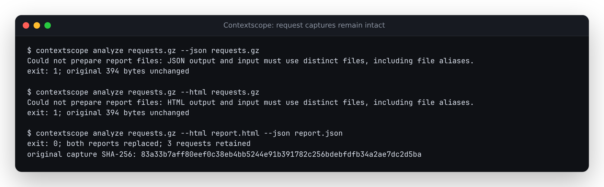

# Keep request captures intact when writing reports

Source correction, verified 2026-10-12. No npm release or hosted deployment.

At baseline `24fd8b38820ae7b297c8ceb0a3922884cfb7a96e`, the CLI read a request
file and then allowed `--json` or `--html` to overwrite it. The retained
[SDK fixture](../../tests/fixtures/sdk/openai-cache-tool-output.jsonl.gz)
contains three synthetic requests serialized by OpenAI Python 2.54.0 through
a mocked transport, with no provider calls. Its [capture script](../openai-cache/generate-sdk-fixtures.py)
and provenance predate this correction. Only disposable copies were overwritten.

| Destination | Before | After |
| --- | --- | --- |
| Input gzip, direct or through three alias forms | Exit 0; destroys all 394 source bytes | Exit 1; original bytes retained |
| HTML and JSON name the same new or existing file | Exit 0; JSON replaces HTML | Exit 1 before either write |
| Distinct ordinary report files | Both reports written | Both reports written; same analysis |

The JSON overwrite produced 12,579 bytes; HTML produced 5,931 bytes. Unlike an
atomic replacement, the old direct writes also truncated the source through
outside hard links and symlinks. The [before receipt](before.json) and
[after receipt](after.json) each contain twelve actual CLI calls: two formats
across four input aliases, and four ways for the reports to collide. Both
also replace two ordinary reports and recover all three requests.



The CLI now validates all paths before reading/analyzing or optional network
calibration. It compares resolved parent paths and existing file identities;
all output symlinks and non-regular files are refused. Reports are prepared in
private temporary sibling files, flushed, and only then renamed over their
destinations. A failed second staging write leaves both old reports intact;
a failed replacement leaves that destination intact. Tests inject those
failures and check temporary-file cleanup. Existing ordinary reports can still
be replaced. New/replaced report files use mode 0600 on POSIX.

The [real write-failure replay](write-failure.py) separately gives only the
child process a 7,000-byte POSIX per-file limit. HTML fits; JSON receives the
operating system's `EFBIG` error. [Before](write-before.json), HTML was replaced
and JSON was truncated to 7,000 bytes. [After](write-after.json), both previous
reports and the request capture remain byte-identical, no temporary files
remain, and the CLI exits 1 with a short error instead of a stack trace. This
does not fill a disk or change limits for the invoking shell.

Each rename is atomic, but the two renames are not a joint transaction: failure
of the second rename can leave the first report updated. The guard is not a
lock against concurrent filesystem changes, does not promise whole-machine
power-loss recovery, and cannot protect targets opened by shell redirection.

## Replay

Build the CLI, then choose a directory that does not already exist:

```sh
npm ci
node studies/report-destinations/replay.mjs /tmp/contextscope-report-check dist/cli/index.js
```

The script retains disposable inputs, safe reports, `replay.json`, and the
terminal receipt. To reproduce the destructive old behavior safely, build the
baseline in a separate checkout and pass its CLI path plus `before`, using a
different new directory. An installed package's `dist/cli/index.js` can be
passed directly; the script invokes the current Node executable from the
disposable case directory.

On POSIX systems, replay the operating-system failure with another new directory:

```sh
python3 studies/report-destinations/write-failure.py /tmp/contextscope-write-failure dist/cli/index.js
```

The safe JSON report is byte-identical before and after. HTML is identical
after normalizing only its single generation timestamp. The receipts retain
both raw and normalized hashes. Analysis, report content and CI gate meanings
are unchanged.

## Clean build and installed package

Implementation `11132ba4c9da9878e6af3398fc6d60d6d555d488` was archived to a new
directory. Under Node 24.21.0, fresh `npm ci`, lint, type checking, all 523 tests,
core/web builds, all 92 existing Chromium/Firefox workflows and `npm pack`
passed. All 413 tracked archive files remained unchanged. The CLI receipt
screenshot above was inspected. No report or browser rendering code changed.

The 97,466-byte package archive was then installed into two new directories,
without running its lifecycle scripts. Both Node **20.0.0** and **24.21.0**
passed the twelve destination checks, safe report replacement and the real
POSIX write-failure replay. All **94** installed `dist` files match the clean
build. Installed JSON matches the source byte for byte; installed HTML matches
after the same single-timestamp normalization. Raw hashes are retained in
[verification.json](verification.json).

Package SHA-256:
`5e049678b86c08a7de79661fd2f4c535f39cc4a1ba07c6631206a3f819f74694`.
This verifies the local packed artifact; the npm version remains 0.3.3.
