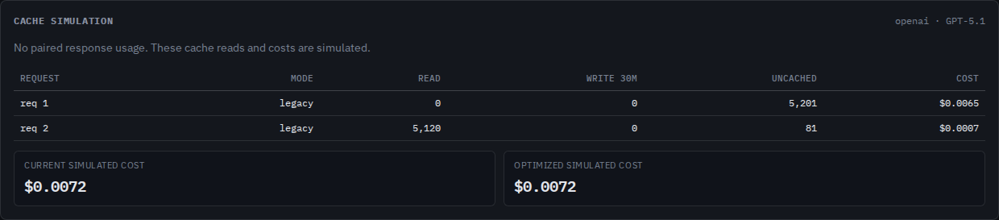
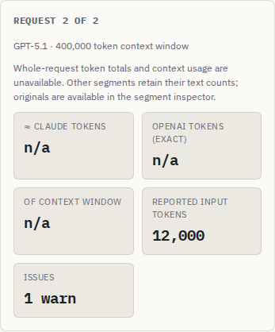

# A request body is not always the whole prompt

At baseline `ecc601b`, two Responses requests with identical visible input but
different `previous_response_id` values predicted 5,120 cached tokens on the
second request. Changing a conversation or reusable prompt had the same problem.
Bare SDK input references (`{"id":"..."}`) disappeared entirely, producing zero
tokens for a reference-only request. Explicit references, reasoning items and
encrypted compaction were counted as their JSON transport instead.

The correction preserves these units as unresolved context. Visible text keeps
its local counts, but whole-request totals/context fractions and the entire
sequence's cache partitions and input costs are unavailable. No remote history
or prompt is fetched. Identical reference strings do not establish a token
length, resolved prompt equality or actual cache reuse.

This is a source correction. Publication, installed-artifact and public-demo
verification are recorded separately as they are completed. No npm release is
performed by this study.

## What is unresolved?

| Native request unit | Preserved evidence | Local treatment |
| --- | --- | --- |
| `previous_response_id` | Original ID | Earlier response context is absent |
| `conversation` string or `{id}` | Original reference | Stored conversation items are absent |
| `prompt` | ID, version, variables | Reusable template is unresolved |
| Input `item_reference`, omitted or null `type` with an ID | Original unit | Referenced input item is absent |
| Input `reasoning` | ID, summary/content and any encrypted payload | Provider reasoning-history rendering is not reconstructed |
| Input `compaction` | Original encrypted unit | Opaque compacted history is not tokenized as text |

The `reference` category is an addressable source unit with no treemap area.
Reasoning keeps its existing `thinking` category. Each unresolved segment has
`unmodeledContext`, both token counts `null`, empty analyzed text and its original
`raw`/prefix identity. IDs and ciphertext are compared exactly even in the
optimized scenario; volatile-text normalization cannot turn distinct references
into equality. Structural comparisons describe captured units only.

Reasoning is withheld conservatively even when a summary or visible content is
present. The analyzer does not know how that returned history is rendered or
resolved by the provider. This does not establish that all visible reasoning
text is inherently uncountable. It is an explicit modeling boundary.

Literal JSON inside user text, metadata, tool arguments and schema examples is
ordinary text/data. `store` controls persistence rather than supplying stored
input, and null context controls add no reference. Inline messages with an ID,
role and content are still inline messages. Nonempty reference IDs and the
documented exclusion between `conversation` and `previous_response_id` are
validated; this is targeted validation, not complete API request validation.

OpenAI's [conversation-state guide](https://developers.openai.com/api/docs/guides/conversation-state)
describes durable conversations and previously stored response context. The
[Responses migration guide](https://developers.openai.com/api/docs/guides/migrate-to-responses#3-update-multi-turn-conversations)
explains that prior input remains billable when using a previous response.
[Reusable prompts](https://developers.openai.com/api/docs/guides/text?api-mode=responses#version-prompts-in-code)
are server-side templates. The native SDK contracts and actual request bytes
establish the serialized reference shapes. Checked 2026-10-16.

## Controlled evidence

The [manifest](captures/manifest.json) records 22 application workflows serialized
by the actual OpenAI Python SDK 3.23.0 over a mock HTTP transport. Stored responses
and conversation IDs are seeded through that same mock client; those seed bodies
are deliberately absent from the imported logs. All IDs, replies, encrypted
strings and usage counters are synthetic controls. There are no provider calls,
model inference, stored-object fetches, measured charges or live API acceptance
claims. The previous-response-only defensive case is explicitly labelled as
acceptance-unverified.

| Controlled second request | Baseline local input | Baseline simulated read | Corrected local input/read |
| --- | ---: | ---: | --- |
| Different previous response | 5,201 | 5,120 | Unavailable / unavailable |
| Same previous response | 5,201 | 5,120 | Unavailable / unavailable |
| Different conversation | 5,201 | 5,120 | Unavailable / unavailable |
| Different reusable prompt | 5,201 | 5,120 | Unavailable / unavailable |
| Bare item reference only | 0 | 0 | Unavailable / unavailable |

The [baseline reports](results/before.json) disagree with 19 expected workflow
outcomes; the [corrected reports](results/after.json) have no discrepancies.
Expectations specify source paths that cannot supply their resolved context;
the simulator does not supply expected numerical token values for unknown units.
Three ordinary text/storage/null controls preserve their complete baseline JSON
reports. These controls are not an empirical provider accuracy rate.

The original browser prediction:



The corrected report keeps captured usage separate from an unavailable estimate:



Paired usage controls retain input `12,000` and reads `0` then `400`, with their
original source paths. Local totals, deltas and hit classifications stay
unavailable. The browser displays reported input separately from local estimates;
it does not substitute that count into a treemap or a modeled context fraction.
Standalone native response objects remain incomplete non-request records;
their echoed tools cannot create another prompt or implicitly join usage.

## Reproduce

```sh
npm ci
node studies/stored-context/replay.mjs /tmp/stored-replay.json dist --verify
node dist/cli/index.js analyze studies/stored-context/captures/reported-usage.jsonl.gz --verbose --json /tmp/stored.json --html /tmp/stored.html
```

Regenerate native captures only when needed:

```sh
uv run --no-project --with openai==3.23.0 studies/stored-context/capture.py
```

Build the app with `npm run build`, serve it with
`npm run preview:web -- --host 127.0.0.1 --port 4341`, and run
`node studies/stored-context/browser.mjs http://127.0.0.1:4341/contextscope/ /tmp/stored-browser --verify`.
The driver disconnects before the first import, compares actual JSON downloads
with CLI/core reports, opens offline HTML, downloads original references, checks
keyboard finding navigation, rejects conflicting controls without losing the
prior report, and recovers to ordinary text in Chromium and Firefox at desktop
and 375px widths.
