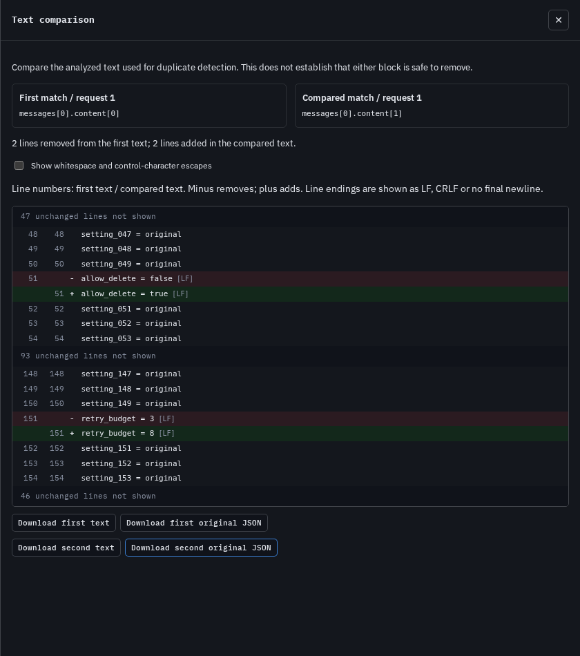

# Read the edits inside a duplicate group

At baseline `e835a2f`, two text blocks in the same message had identical
inspection button labels. Reviewing differences required opening one original
at a time. The retained [baseline browser receipt](results/baseline-browser.json)
records this in Chromium and Firefox, at 1440px and 375px.

The source browser displays each member's request number and full source path.
**Compare with first** opens a literal line comparison with three unchanged
lines of context around each edit. Both source positions remain visible. The
example picker now exposes the existing
[three configuration snapshots](../../examples/anthropic-edited-repeats.json).
The similarity detector and its grouping rules have not changed.



The [phone view](../../docs/assets/text-comparison/chromium-375-comparison.png)
keeps both edits readable at 375px. The
[baseline member controls](../../docs/assets/text-comparison/before-chromium-1440.png)
and [distinct source controls](../../docs/assets/text-comparison/chromium-1440-sources.png)
show the before/after navigation.

Only the existing first 20 member controls are displayed; each later displayed
member can be compared with the first. This is not arbitrary pair selection.
The comparison uses analyzed text, which can be identical when raw metadata
differs. Both complete analyzed texts and original JSON objects are downloadable.
No text or raw object is added to the portable JSON/HTML reports.

## Literal content and explicit limits

Case, whitespace, CRLF/LF and a missing final newline remain significant.
Changed lines show their endings; an optional escaped display exposes tabs,
spaces at line ends and invisible controls. Source markup is rendered as text.
UTF-8 text downloads preserve valid Unicode. An unpaired surrogate instead
gets a JSON-string download, with an explanation, so it is not silently replaced.

Unequal inputs above 500,000 combined JavaScript string code units or 10,000
combined lines do not get an inline preview. The line differ is bounded by
512 edits and a 40ms algorithm timeout. This timeout does not bound the whole
UI event, tokenization, line splitting, DOM rendering or downloads. Completed
previews are withheld if their displayed content exceeds 32,000 code units or
600 rows. Exact equality is checked first, including for larger strings.

Every refusal explicitly says the text differs and offers the complete files;
it never presents a partial diff or implies equality. A successful preview may
fold unchanged intervals but retains every changed line. Similarity and a diff
do not establish that a read is safe to remove.

The browser bundles pinned [jsdiff 9.0.0](https://github.com/kpdecker/jsdiff).
Its BSD-3-Clause notice is served verbatim and linked from the footer.
The dependency is development-only because the library and CLI do not use it.

## Reproduction

`cases.mjs` constructs seven inputs: two distant configuration edits, exact
text, whitespace/endings, literal HTML, an oversized comparison, unpaired
surrogates and a comparison opened while another request is selected. These
are authored inputs, not provider traffic or production-frequency estimates.

After a locked install and build:

```sh
node studies/text-comparison/browser.mjs . /tmp/browser.json /tmp/screens chromium 375
node studies/text-comparison/replay.mjs dist /tmp/cli /tmp/cli.json
```

Omit the browser engine/width arguments to run all four combinations. For long
verification sessions, run each combination separately. The browser script
loads the bundled example and fonts, verifies the bundled license, then
disconnects before the seven cases. It checks complete downloads, literal
changes, keyboard focus, both-theme accessibility, exported offline reports,
and served asset bytes. It does not test reloading the app without a network.

The independent `oracle.mjs` (Node 24+) reconstructs both original texts from
the preview rows and omitted source intervals. It checks 400 seeded mutations
and all first-to-later-member pairs in the 240 pinned terminal snapshots from
the [public trajectory audit](../duplicate-evidence/README.md), including
members beyond the first 20 browser controls. It verifies original and
reconstructed source hashes before use:

```sh
node studies/text-comparison/oracle.mjs . /path/to/reconstruction /tmp/oracle.json
```

The reconstruction directory contains `reconstruction.json` and `bodies/` from
the earlier study. Original public trajectories must be in
`studies/real-trajectories/cache/`. Corpus data is not embedded in these receipts.
The oracle proves faithful completed previews, not a minimal edit script or
semantic removability. Timeout fallback counts can vary across machines.

## Retained checks

The [clean-build oracle receipt](results/oracle-clean.json) records all 400
generated cases completing with faithful previews. Across 240 public terminal
snapshots, 466 groups contain 599 first-to-member pairs: 433 identical texts
and 166 completed differences, with no limited previews in this run. Every
completed difference reconstructs both original strings, including every
folded interval. This does not claim that all 599 pairs are distinct texts or
that their source reads can be deleted. This run's count is not a guarantee
that every machine completes those previews within the work limit.

The clean archive of implementation `9728b73` passes fresh locked installation,
lint, both type checks, 538 tests in 41 files and both production builds. All
467 tracked entries still match that commit after verification. All 141
compiled CLI/library files, including maps, are byte-identical to baseline.
The separate Node 20.0.0 and 24.21.0 package installs retain all 94 shipped
compiled files and do not install jsdiff as a production dependency.

Seven actual CLI inputs preserve complete JSON reports and HTML reports except
their single checked generation timestamp: [baseline](results/cli-before.json),
[clean source](results/cli-clean.json), [Node 20](results/cli-node20.json) and
[Node 24](results/cli-node24.json). The browser-only feature does not change
the package's analysis or report semantics.

[verification.json](results/verification.json) records those checks and the
98,574-byte tarball, SHA-256
`e502f1b0c5f6b9ccf76e3044717d83cb891a745a8986f5c7aec579aed320be51`.
Its path placeholders refer to the clean archive, original checkout, scratch
directory, public reconstruction and separately selected Node runtimes.

All 74 workspace browser checks pass on Chromium 153 and Firefox 155. The
dedicated clean production-build review covers seven cases at both 1440px and
375px in each engine: 28 offline workflows, with both themes checked for axe
violations in every case. The receipts retain each complete download's hash,
source labels, full report hashes and the bytes actually served by the browser:
[Chromium desktop](results/browser-chromium-1440.json),
[Chromium phone](results/browser-chromium-375.json),
[Firefox desktop](results/browser-firefox-1440.json) and
[Firefox phone](results/browser-firefox-375.json).

Every case preserves focus on close, keyboard wrapping, original-inspector
navigation and complete report exports, with no page errors, unexpected
network requests, horizontal overflow or axe violations. The 12 retained
[before/after screenshots](results/screenshots.json) were inspected. A browser
comparison's recorded opening duration includes automation and rendering; it
is not an algorithm benchmark or a UI latency guarantee. Build the browser
with `npm run build:web`; its static output is `web/dist/`.

This is a source browser feature. No hosted deployment or npm release is part
of this change; the package version remains 0.3.3.
