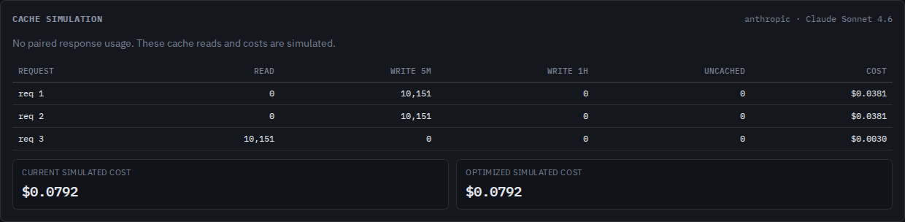

# Thinking settings are part of a cache boundary

At baseline `b295f6d`, changing a Claude thinking budget from 2,048 to 4,096
while keeping the prompt identical predicted a read of all 10,151 modeled
tokens. Changing top-level effort had the same problem. A separate parser
omission erased empty system messages containing a per-message effort change.

The source now keeps top-level reasoning settings in separate cache scopes and
retains empty message headers in prompt identity. This is an unreleased
source correction. There is no npm release or hosted deployment associated
with this study. The later source publication is recorded below.

Open the retained [budget-change request file](captures/budget-change.jsonl.gz)
in the browser's file chooser to inspect the three-request example.

## Rules and the conservative assumption

[Claude's thinking/caching documentation](https://platform.claude.com/docs/en/build-with-claude/thinking#thinking-and-prompt-caching)
states that thinking mode, extended-thinking budget and top-level effort
changes invalidate message entries. Whether tool and system entries survive
depends on the model's hidden prompt placement. The documentation recommends
treating these changes as restarting the cache.

Contextscope follows that conservative approach: it isolates tools, system and
messages together across these settings. The new finding names that assumption
and says actual setup reuse and costs may differ. A modeled zero across the
whole prompt is **not a measured provider miss**. Content-prefix matches remain
unchanged; equal text can be useful evidence without being a reusable cache.

Previously cached entries remain available when their configuration returns:

```text
request 1: budget 2048 -> write configuration A
request 2: budget 4096 -> write configuration B; no modeled read from A
request 3: budget 2048 -> read the original configuration A
```

Explicit default thinking modes and effort levels match omission only when the
recorded model has a known documented default. This includes disabled thinking
on Sonnet 4.6, adaptive thinking and medium effort on Opus 5.5, and high effort
on Sonnet 5.5. Model aliases use the existing normalizer. Missing/unknown model
IDs stay unspecified; `--model` changes pricing assumptions, not the original
model's settings identity. Sources: [thinking defaults](https://platform.claude.com/docs/en/build-with-claude/thinking#configuring-thinking)
and [effort defaults](https://platform.claude.com/docs/en/build-with-claude/effort#effort-levels),
checked 2026-10-16. Response thinking display and maximum output length do not
change the reasoning scope. Unrecognized thinking fields remain conservative.
This does not implement complete request validation or prove provider acceptance.

[Per-message effort](https://platform.claude.com/docs/en/build-with-claude/effort#per-message-effort-beta)
can change after the cached prefix on supported models/platforms with the
required beta header. An empty `role: "system"`, `content: []` message carrying
`output_config.effort` now remains an inspectable structural unit. It contributes
no invented text tokens, occupies no content-block lookup position, and cannot
receive an automatic or hypothetical cache marker. Its header affects the
prefix of subsequent content. Appending it preserves earlier cache entries;
editing it blocks reuse past that position. The raw inspector download retains
the complete original message.

## Controlled observations

These are synthetic application requests serialized by the actual Anthropic
Python SDK 1.15.0 over a mock HTTP transport. No provider was contacted. The
fixed mock reply is not a model completion or a token/cache measurement.
[`captures/manifest.json`](captures/manifest.json) records SDK/Python/HTTP
implementation versions and exact compressed/uncompressed hashes. Twelve
workflows cover changed settings, explicit defaults, unchanged histories,
key-order changes, output-limit controls, unknown model defaults and message
effort. The unknown model is a defensive import control, not a supported-model
claim.

| Second request | Baseline modeled reads | Corrected modeled reads | Corrected 5m writes |
| --- | ---: | ---: | ---: |
| Sonnet 4.6 budget 2048 -> 4096 | 10,151 | 0 | 10,151 |
| Sonnet 4.6 thinking off -> enabled | 10,151 | 0 | 10,151 |
| Opus 4.6 effort high -> medium | 10,151 | 0 | 10,151 |
| Opus 5.5 effort-only message high -> low | 10,166 | 10,151 | 15 |
| Opus 5.5 explicit defaults | 10,151 | 10,151 | 0 |
| Appended effort-only message | 10,151 | 10,151 | 17 |

The budget example's simulated second-request input cost changes from
$0.0030453 to $0.03806625 under the conservative scope and this checkout's
Sonnet 4.6 input rates. This is not an observed bill. Both simulation scenarios
conserve the estimated token total and preserve the same setting boundaries.

[`before.json`](results/before.json) and [`after.json`](results/after.json)
retain all reports. Four documented-boundary failures and the conservative
unknown-default control disagreed with expected boundaries before; all twelve
agree after. These controls are not a census or a provider accuracy study.

## Reproduce

From the repository root:

```sh
npm ci
node studies/thinking-settings/replay.mjs /tmp/thinking-replay.json dist --verify
node dist/cli/index.js analyze studies/thinking-settings/captures/budget-change.jsonl.gz --verbose --json /tmp/thinking.json --html /tmp/thinking.html
```

To regenerate only the synthetic SDK body captures:

```sh
uv run --no-project --with anthropic==1.15.0 studies/thinking-settings/capture.py
```

The replay also accepts an installed package's `dist` directory. It checks the
retained input hashes, compares explicit expected prefix boundaries, verifies
token conservation and records compiled implementation hashes. It does not
use the cache simulator itself to compute those expected boundaries.

Browser verification disconnects before the first local import, checks the
actual JSON download against the CLI's complete report, opens the actual HTML
download from disk and inspects the empty message's original JSON. It runs in
Chromium and Firefox at 1440 and 375 pixels, with axe, keyboard and page-width
checks. Start a production preview, then run:

```sh
npm run build
npm run preview:web -- --host 127.0.0.1 --port 4334 --strictPort
# In another terminal:
node studies/thinking-settings/browser.mjs http://127.0.0.1:4334/contextscope/ /tmp/thinking-browser --verify
```

## Clean and installed verification

The tested source is local commit
`efbd97888fc224168a0c4a4f6b47fbf2bc0dc60d`. A clean Git archive with a fresh
Node 24.21.0 install passed `npm run lint`, `npm run typecheck`, all 577 unit
checks, `npm run build` and all 102 production Chromium/Firefox checks.
The web build output is `web/dist/`, with base `/contextscope/`; the CLI and
library build into `dist/`.

The separately packed npm tarball was installed outside the checkout with
its runtime dependency. All twelve replay outputs are byte-identical to the
source on Node 24.21.0 and the minimum Node 20.0.0. Both runtimes' CLI JSON
reports for the budget and message-effort controls equal the complete source
reports. Their budget HTML equals the actual browser download after replacing
only its one generated timestamp.

The [verification receipt](results/verification.json) records hashes for the
source archive and tarball, 114 matching source/build inputs (including one
symlink), 96 matching installed files and all 42 matching served production
files. The [browser receipt](results/browser.json) retains sixteen workflows
before and sixteen after, spanning both engines and widths. All final JSON
downloads match the CLI reports. The actual [budget HTML download](results/browser-budget.html)
and four JSON downloads are retained alongside the receipt.

No page exceptions, HTTP requests after disconnecting, axe violations or
page-width overflow occurred in these study workflows. The cache table retains
its existing horizontal scroll inside the panel on phones. All four retained
screenshots were opened and inspected; the conservative assumption and corrected
counts remain readable. This verifies local artifacts, not the public site or
the registry's released package.

| Desktop cache table | Capture |
| --- | --- |
| Baseline: request 2 incorrectly reuses the entire prompt | [Before](../../docs/assets/thinking-settings/before.png) |
| Corrected: request 2 writes; request 3 returns to its earlier configuration | [After](../../docs/assets/thinking-settings/after.png) |



The [phone finding](../../docs/assets/thinking-settings/finding-phone.png)
explains the model-specific setup limit; the [Firefox phone table](../../docs/assets/thinking-settings/cache-phone.png)
shows the actual counts and simulated cost totals.

`verify-artifacts.py SCRATCH BASE_URL` checks the retained run against its clean
archive, installed files, raw browser downloads and served bytes. Full command
logs remain in the local run directory; the receipt records their hashes and
exit statuses without publishing machine paths. No push, package release or
hosted deployment was performed.

## Public source

After local verification, source commit
`20ab1235e2bbbb9b09431f7b4f93b9699b5612b8` was pushed to `main` with the
owner's authorization. The [source receipt](results/publication.json) checks
remote `main` equality and thirteen immutable raw-file responses against local
bytes, including runtime code, SDK-capture metadata and before/after reports.
This establishes published source for that revision. It does not establish a
registry release or hosted deployment.

## Limits

The simulator still estimates tokens, assumes requests arrive within the TTL,
and does not reproduce hidden prompt rendering or thinking-block stripping.
Configuration equality is not evidence that an actual cache hit occurred.
The default table is a dated Claude API assumption, not a historical or
cross-platform default guarantee. Unknown fields can cause conservative misses.
The repair does not infer provider feature support, beta headers, historical
prices or actual response settings from a body alone.
